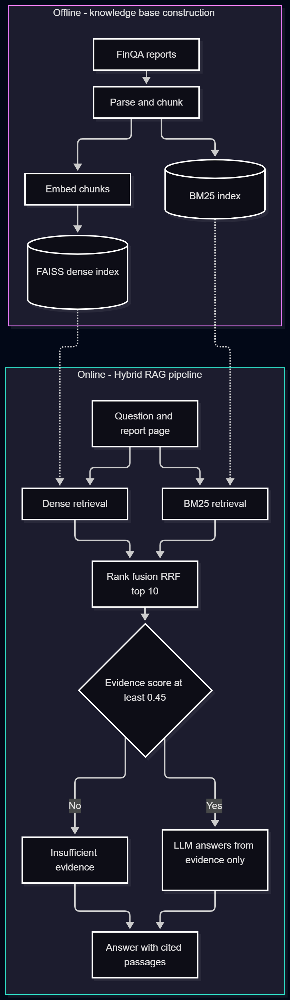

# An Explainable Hybrid RAG Framework for Financial Document QA

Capstone project, University of Moratuwa
Raveesha Batepola (Index: 268491B)

Question answering over FinQA earnings-report pages. Three configurations are compared on identical questions: an LLM with no retrieval, dense-only RAG, and hybrid RAG (BM25 + dense retrieval, Reciprocal Rank Fusion, an evidence-score threshold, and cited passages). The same LLM (openai/gpt-oss-120b via Groq), prompts, K=10 and scoring are used for all three.



## Main results (test set, 150 randomly sampled questions)

All design choices and the threshold were fixed on the dev set before the test set was used.

| config | EM % | Rounded match % | F1 % | abstained |
|---|---|---|---|---|
| LLM only | 3.3 | 3.3 | 3.3 | 0 |
| Dense RAG | 33.3 | 61.3 | 33.3 | 18 |
| Hybrid RAG | 34.7 | 59.3 | 34.7 | 17 |

- Exact Match (EM) is strict because FinQA gold answers have a fixed format.
- Rounded match accepts a prediction equal to the gold answer rounded to the prediction's precision (73.0 for 73.01) and percentages written as fractions. It still rejects guesses such as 5 for 4.74.
- Retrieval helps substantially: on the strict numeric-match metric, Dense RAG beats LLM-only by 56.0 points (95% CI +47.3 to +64.7, paired bootstrap).
- Hybrid RAG and Dense RAG are not distinguishable: -1.3 points (95% CI -6.7 to +4.0), with only 16 of 150 questions differing between them.
- The LLM-only baseline was instructed to always give a best guess, so its near-zero score reflects a forced-guess design and is not the hallucination rate of an unconstrained LLM.

Dev set, same 150-question protocol:

| config | EM % | Rounded match % | F1 % | abstained |
|---|---|---|---|---|
| LLM only | 0.7 | 0.7 | 0.7 | 0 |
| Dense RAG | 36.0 | 56.7 | 36.2 | 24 |
| Hybrid RAG | 35.3 | 56.0 | 35.6 | 20 |

## Retrieval (all questions, correct report page given)

Test set:

| method | R@5 | R@10 | MRR | Full@10 |
|---|---|---|---|---|
| BM25 | 0.820 | 0.907 | 0.780 | 0.838 |
| Dense | 0.793 | 0.890 | 0.749 | 0.817 |
| Hybrid (RRF) | 0.822 | 0.914 | 0.783 | 0.843 |

Dev set:

| method | R@5 | R@10 | MRR | Full@10 |
|---|---|---|---|---|
| BM25 | 0.830 | 0.932 | 0.804 | 0.877 |
| Dense | 0.802 | 0.913 | 0.775 | 0.847 |
| Hybrid (RRF) | 0.843 | 0.929 | 0.817 | 0.866 |

Open retrieval (the report page is not given), test set:

| method | R@5 | R@10 | MRR | Full@10 |
|---|---|---|---|---|
| BM25 | 0.565 | 0.643 | 0.574 | 0.525 |
| Dense | 0.521 | 0.590 | 0.508 | 0.486 |
| Hybrid (RRF) | 0.598 | 0.664 | 0.586 | 0.550 |

Full@10 is the share of questions for which all gold evidence passages are in the top 10. Hybrid fusion gives small gains over the better single retriever on dev (MRR 0.817 vs 0.804 for BM25); gains are larger in open retrieval.

## Where errors come from (test set, Hybrid RAG)

When all gold evidence was in the top 10, the strict numeric match was about 63%. When evidence was missing it was about 27%, but that group is small (22 questions). From the printed percentages, roughly 47 of the 63 wrong answers (approximate) had all gold evidence retrieved, so generation (misreading the question, wrong number chosen, arithmetic, over-refusal) is a larger bottleneck than retrieval. About 6 to 8 of 128 questions with full evidence were refused by the model.

## Does the evidence check reduce hallucination?

Stress test on dev: 40 questions, each paired with a report from a different company.

| Configuration | Refused | Answered wrongly |
|---|---|---|
| Dense RAG (prompt abstention only) | 39 of 40 | 1 |
| Hybrid RAG, no threshold | 39 of 40 | 1 |
| Hybrid RAG + threshold 0.45 | 39 of 40 | 1 |

- The threshold refused 31 of 40, but the LLM had already refused all 31 itself, so the threshold prevented no additional wrong answers. The grounding instruction in the prompt did the work.
- The single hallucination had a high evidence score (0.619), above any threshold that would be safe for real questions.
- With the correct report supplied, the threshold fired on 1 of 150 dev questions and 0 of 150 test questions.
- Its measured benefit is saving LLM calls when the report is wrong. It did not improve accuracy or reduce hallucination in these experiments.

## Faithfulness check

45 random Hybrid RAG test answers were compared with their cited passages. Labels were produced by an LLM from the passages alone, and were independently verified by the author. This replaces the planned fully manual review and is not a blind, multi-judge evaluation.

- Answered questions: 37 of 40 supported by their passages (92.5%, 95% interval 80% to 97%).
- Refusals: 5 (2 appropriate, 3 false).
- Of the wrong answers, 10 were supported by the passages (reasoning or interpretation errors) and 1 was not. Two unsupported answers were nevertheless correct.

## Table format comparison

Not completed. Table rows are written as sentences; no alternative format was tested.

## Known limitations

- Answer comparisons use 150 questions per split because of free-tier API limits. Differences of a few points are within noise.
- Single dataset (FinQA); results may not generalize.
- Arithmetic is done by the LLM; there is no calculator component.
- Scoring ignores units, so 3.8 million and 3.8 count as equal.
- The evidence threshold was calibrated on simulated unanswerable questions (random wrong reports).
- The faithfulness review used a single, LLM-assisted judge on 45 items.
- The optional cross-encoder reranker was not implemented.
- No model training or fine-tuning was done.

## Run the interface

```bash
streamlit run app/streamlit_app.py
```

Select an example question, choose LLM only, Dense RAG or Hybrid RAG, and view the answer with the passages it was based on (gold evidence is marked for example questions). Each answer uses one LLM call.

## Reproduce

```bash
git clone https://github.com/RaveeshaBatepola/capstone.git
cd capstone
python -m venv venv
venv\Scripts\activate
pip install -r requirements.txt
```

1. Download FinQA `train.json`, `dev.json`, `test.json` from https://github.com/czyssrs/FinQA (folder `dataset`) into `data/raw/`.
2. Create `.env` with `GROQ_API_KEY=...` and `GROQ_MODEL=openai/gpt-oss-120b`.
3. Run in order:

```bash
python -m src.chunker
python -m src.indexer dev test
python -m src.eval_retrieval dev
python -m src.eval_hybrid dev
python -m src.run_baselines llm_only dev --n 150 --sleep 3
python -m src.run_baselines dense_rag dev --n 150 --sleep 8
python -m src.run_baselines hybrid_rag dev --n 150 --sleep 8
python -m src.eval_answers dev
python -m src.stress_test hybrid --n 40
python -m src.stress_test dense --n 40
python -m src.stress_test report --n 40
```

Repeat the retrieval and answer steps with `test` for the final results. Data, indexes and API keys are not stored in this repository.
