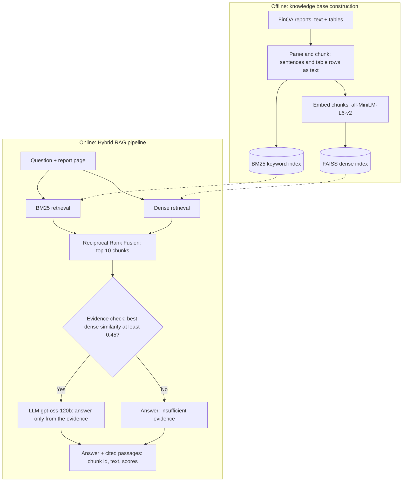

# An Explainable Hybrid RAG Framework for Financial Document QA

Capstone project, University of Moratuwa
Raveesha Batepola (Index: 268491B)

Question answering over FinQA earnings-report pages, comparing three configurations: an LLM with no retrieval, dense-only RAG, and a hybrid RAG pipeline (BM25 + dense retrieval, rank fusion, evidence check, cited answers).

## Architecture



## Progress

- [x] Data processing: FinQA parsed into 61,146 train chunks (text sentences and table rows written as sentences); 99.9% of gold evidence maps to a chunk
- [x] EDA: question types, chunk lengths, table sizes, evidence types
- [x] Baselines: BM25, dense retrieval, LLM-only, Dense RAG
- [x] Improved method: Hybrid RAG with Reciprocal Rank Fusion and an evidence threshold
- [ ] Stress test of the evidence check on questions paired with a wrong report
- [ ] Faithfulness review of cited answers (manual sample)
- [ ] Streamlit interface

## Results so far (dev set, preliminary)

**Retrieval** (all 883 dev questions, correct report page given)

| Method | Recall@5 | MRR | Full@10 |
|---|---|---|---|
| BM25 | 0.830 | 0.804 | 0.877 |
| Dense | 0.802 | 0.775 | 0.847 |
| Hybrid (RRF) | 0.843 | 0.817 | 0.866 |

Without knowing the report (open retrieval), Recall@10 is 0.650 (BM25), 0.627 (Dense) and 0.705 (Hybrid).

**Answers** (150 dev questions, a fixed random sample identical for all configurations)

| Configuration | Exact Match | Rounded match | Token F1 |
|---|---|---|---|
| LLM only | 0.7% | 0.7% | 0.7% |
| Dense RAG | 36.0% | 56.7% | 36.2% |
| Hybrid RAG | 35.3% | 56.0% | 35.6% |

- Retrieval helps a lot: Dense RAG beats LLM-only by 54.7 points (95% CI +46.7 to +63.3).
- Hybrid RAG and Dense RAG are not distinguishable on this sample (-0.7 points, 95% CI -5.3 to +4.0). The hybrid retrieval gains are small, and 150 questions cannot detect effects that small.
- The evidence threshold fired on only 1 of 150 questions when the correct report was supplied. Whether the evidence check reduces hallucination has not been tested yet.
- Exact Match is strict because FinQA gold answers have a fixed format. Rounded match accepts a prediction that equals the gold answer rounded to the prediction's precision (73.0 vs 73.01), and percentages written as fractions.

All numbers are on the dev set. The test set has not been used.

## Reproduce

```bash
git clone https://github.com/RaveeshaBatepola/capstone.git
cd capstone
python -m venv venv
venv\Scripts\activate
pip install -r requirements.txt
```

1. Download FinQA `train.json`, `dev.json`, `test.json` from https://github.com/czyssrs/FinQA (folder `dataset`) into `data/raw/`
2. Create `.env` with `GROQ_API_KEY=...` and `GROQ_MODEL=openai/gpt-oss-120b`
3. Run in order:

```bash
python -m src.chunker
python -m src.eda
python -m src.indexer
python -m src.eval_retrieval dev
python -m src.eval_hybrid
python -m src.run_baselines llm_only dev --n 150 --sleep 3
python -m src.run_baselines dense_rag dev --n 150 --sleep 8
python -m src.run_baselines hybrid_rag dev --n 150 --sleep 8
python -m src.eval_answers
```

Data, indexes and API keys are not stored in this repository.

## Known limitations

- The answer comparison uses 150 dev questions because of free-tier API limits.
- Single dataset (FinQA); results may not generalize.
- Arithmetic is done by the LLM; no calculator component.
- Scoring ignores units, so "3.8 million" and "3.8" count as equal.