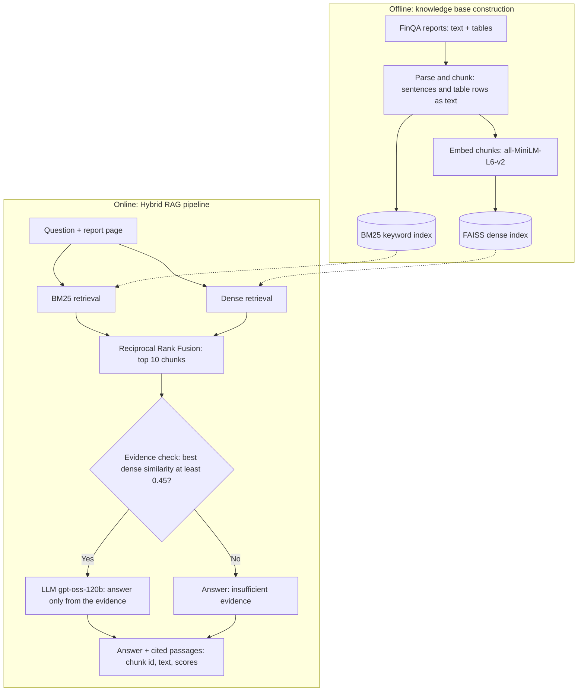

# System Architecture

## Compared configurations

| Configuration | Retrieval | Evidence check | LLM |
|---|---|---|---|
| LLM only | none | none | same model |
| Dense RAG | dense, top 10 | none | same model |
| Hybrid RAG (proposed) | BM25 + dense with RRF, top 10 | threshold 0.45 | same model |